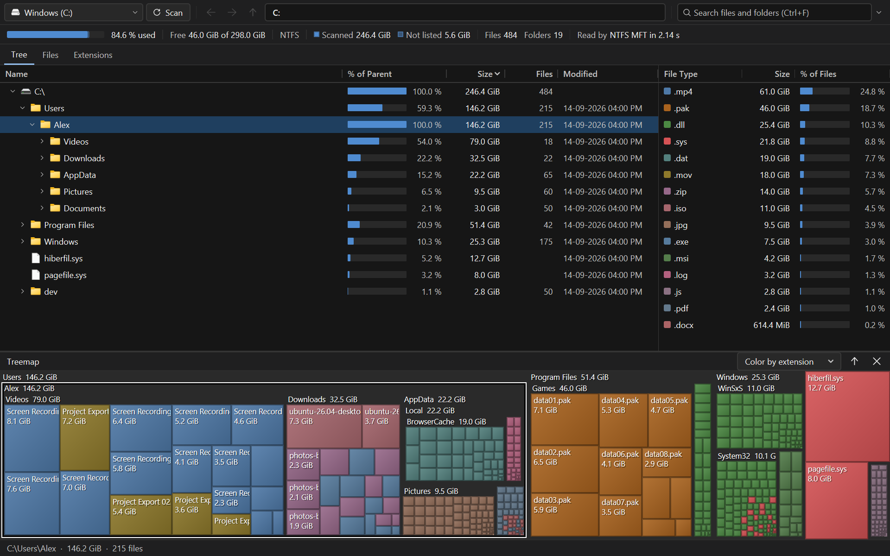
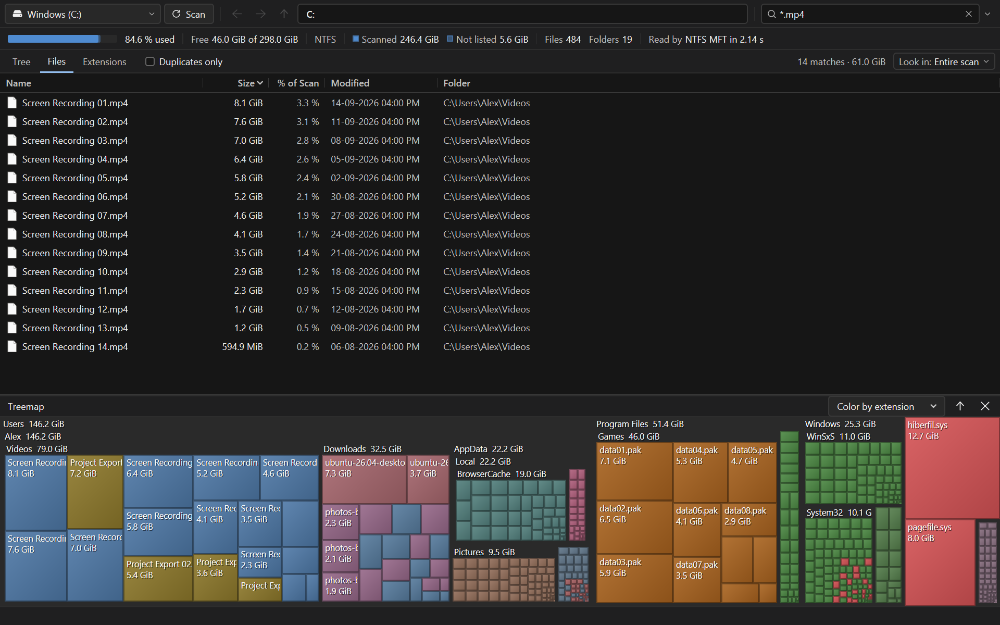

# Quarry 0.2.6

A disk space analyzer for Windows (formerly Stratum), written in Go with the MyGO native UI toolkit (Direct3D, no webview).
Quarry shows where the space went and gets you from a storage problem to the file or folder responsible in a few clicks.

Quarry is an independent project inspired by disk analysis tools such as WizTree.
It is not affiliated with or endorsed by WizTree or Antibody Software.

## License and assets

Quarry's original source and generated artwork are available under the [MIT license](LICENSE).
Dependencies and Fluent icons retain their own licenses; see [third-party notices](resources/licenses/NOTICE.txt)
and [asset provenance](internal/desktop/assets/ASSETS.md). The launcher icon is generated by `scripts/icon.go`.
README screenshots use fictional scan data.

See [publication notes](docs/PUBLISHING.md) for source, history and release checks.



## Layout

From top to bottom: the toolbar (the drive or folder to scan, Scan, back, forward, up, the location and search), the info bar, the view tabs with the controls of the view shown, the table with the file types panel beside it in Tree View, the treemap and the status bar. The window has this layout from the start; before the first scan the table and treemap are empty. Choosing a drive in the drop-down only selects it; Scan (F5) starts, and is Stop while a scan runs.

- **Info bar** - one line of labeled values: the drive's use as a bar in three parts (the scan, used space the scan does not list or the rest of the drive, free space), percent used, free space of capacity (in the warning color at 90 % or more), file system, what the scan holds, its file and folder counts, and the method and time it took; then anything that makes the results differ from the disk (partial scan, skipped entries, unreadable items, an active filter). While scanning it shows progress, counts and elapsed time.
- **Tree** - the folder hierarchy below the current location, sorted by size, with each entry's share of its parent as a bar beside its name. Right/Left expand and collapse (Shift for the whole subtree, bounded at 200,000 rows), Enter or double-click expands folders and opens files, Backspace or Alt+Up goes up.
- **File types panel** - beside the tree: the kinds of files in the scope, largest first, in the treemap's colors, so it is also its legend. Double-click lists a type's files; F8 shows or hides it.
- **Files** - every file in the scope, largest first, or every match of the search. Check **Duplicates only** beside the tabs to review duplicate candidates in the same table, with the usual selection, file actions, sorting and export. Results are complete (no silent limit) and virtualized.
- **Extensions** - space by file type with Windows' type names and its category (videos, archives, installers…). Double-click an extension to list its files.
- **Treemap** - area proportional to size, colored by extension (aggregated blocks take their dominant type), by top-level folder, or monochrome. Click selects the item in Tree View, double-click a folder goes into it, the mouse back button returns. While File View lists a search or duplicates, tiles holding no match are dimmed (View → Highlight Matches in Treemap). Cloud files that are online-only are marked as such.

Selections, the location and the history are shared by the tree and the treemap. Every command lives once in a central registry that drives the menu bar, the context menus and the keyboard shortcuts (Help → Keyboard Shortcuts, F1).

Both themes are held to tested contrast rules: text reaches WCAG 7:1 (secondary text, links and warnings 4.5:1) on every background it is drawn on, and the APCA perceptual measure as well, so grey text stays readable on the dark theme too.

## Working with files

Right-click any entry: Open, Show in Explorer (selects the items), Cut/Copy as real Explorer clipboard items, Copy Full Path (Ctrl+Alt+C), Go Into Folder, Reveal in Tree, Search in This Folder, Scan This Folder, Rename (F2), Delete to the Recycle Bin (Del) and Properties (Alt+Enter). **More** holds Copy Name, Copy Size, Copy Rows as Text (tab-separated), Folder Details, Refresh This Folder (rescans only that folder into the current results), Focus in Treemap, Scan in New Window, Export Selection, Expand/Collapse Subtree, Skip This Folder in Future Scans and Delete Permanently (Shift+Del, always confirmed). Items can be dragged to Explorer; folders dropped on the window are scanned.

Before any operation Quarry checks that the path still exists and is still the same kind of entry; after it, the index, totals, extensions and treemap update without a rescan. NTFS metadata (`$MFT`, `$BadClus`, `$Extend`…), `pagefile.sys`, `System Volume Information` and similar are never offered for deletion or renaming, and items inside Windows or Program Files get an extra warning. After a deletion the status bar says how many items went where; items in the Recycle Bin still take disk space until it is emptied.

**Cleanup basket.** Add to Cleanup Basket (Ctrl+B) collects files and folders from anywhere in the scan. Tools → Cleanup Basket (Ctrl+Shift+B) reviews them: each path with its size, estimated disk space and status (ready, already included in a folder of the basket, protected, changed or gone since the scan). Totals count overlapping items once. Nothing is removed until Move to Recycle Bin or Delete Permanently is chosen there; the basket is not saved and nothing is cleaned automatically.

## Search

Type in the search box (Ctrl+F). Matching is case-insensitive; all terms must match.

```
*.mp4                     wildcards over the whole name (* and ?)
backup  -cache            contains "backup", not "cache"
ext:log size:>500MB       fields can be combined
modified:<2025-01-01      also >, <=, >=, a single day, or a range a..b
path:node_modules         any folder in the path
type:file  type:folder    regex:^IMG_\d+\.jpe?g$
age:>1y  age:<30d         time since the last change (d, w, m, y), or a range age:90d..1y
cat:videos;archives       kind of file; cat:other for the rest
is:cloud  -is:cloud       online-only cloud files; also is:hardlink, is:incomplete
```

Operators are suggested while typing (Tab takes the first). In File View the **Filters** button sets size, age and kind without typing, and the search box's menu holds **Quick Filters** such as files over 100 MB, 1 GB or 10 GB, large files not changed in a year, old downloads, large archives and installers. Both write ordinary search terms and respect the scope.

Tools → Advanced Search builds such a query from fields. The scope is shown next to the results: the current location by default, following navigation, or the entire scan or a selected folder when chosen. Clearing a search started in Tree View returns to it.



**Show/Hide Filter** (Tools → Show/Hide Filter) hides entries that are already scanned - e.g. show only `ext:log`, hide `node_modules` - and recomputes every total. **Skip During Scan** (Options → Skip During Scan) keeps folders or name patterns out of future scans; a warning beside the view tabs then reports how many entries were skipped.

## Scanning

As administrator, whole NTFS drives are read directly from the master file table (seconds for millions of files). Otherwise - and for folders, FAT/exFAT and network drives - Quarry enumerates directories with `FILE_ID_BOTH_DIR_INFO`. The info bar names the method used and the time it took (Read by), and its tooltip why MFT reading was not possible; Options → Restart as Administrator relaunches through UAC.

Sizes: **Size** is the logical length of files, **Allocated** the disk space they occupy (smaller for compressed or sparse files). View → Size Metric, or a column header's right-click menu, chooses which one percentages, default sorting and the treemap use. Hard links are counted once, junctions and symbolic links are not followed, and unreadable folders are reported (in the info bar, and Tools → Scan Issues, where Retry reads the selected item's folder again and Restart as Administrator is one click away). The volume's used space also contains filesystem overhead, so it is shown separately (Tools → Scan Information).

## Saving, exporting, comparing

File → Save Scan As writes a `.quarry` file that opens instantly later (marked as historical data). File → Export writes CSV of the current view, the selection, the entire scan or the extension summary, or JSON. Tools → Compare with Saved Scan compares the current scan with a saved one of the same folder: by folder (double-click to go deeper, breadcrumbs to come back) or as the largest changed files, filtered to added, removed, grown or shrunk, largest change first. Entries of the current scan can be revealed in Tree View or listed in File View; those only in the previous scan are marked as no longer on disk.

**Storage insights** (Tools → Storage Insights, Ctrl+I; right-click a folder → More → Folder Details) are computed on demand from the index: size and counts, the largest folder inside, the dominant kind of file, large files not changed for a year, possible duplicates by name and size, logs and temporary files, installers and archives, online-only cloud files and unreadable items; a **File Age** tab (last 30 days, 30-90 days, 90 days-1 year, 1-3 years, over 3 years, optionally only files over a size) and a **Categories** tab. Every number opens its files in File View.

**Scan history** is off until Options → Remember Scans for Trends is turned on. Then each completed scan keeps a small summary (and, as chosen, the last few full scans) in `%APPDATA%\Quarry\history\`; Tools → Scan History shows the trend, which folders changed between scans, compares a kept scan with the current one in detail, and can alert after a scan when a folder grew by more than a chosen amount. Nothing runs in the background.

File → Export → **Report (HTML)** writes one self-contained web page (totals, largest folders and files, kinds of files, file age) for sharing, optionally with user names replaced or every file and folder name hidden.

In **Files**, check **Duplicates only** for a fast candidate search using the existing scan. It does not read file contents. A line above the table shows the groups, files and space in extra copies, whether contents were compared, a **Minimum size** choice and a stop button while it runs. **Verify Contents** explicitly checks the current scope with SHA-256, including renamed copies; it can take a long time on a large scan. Groups are marked **Verified** or **Candidate**. Only verified groups offer Keep This Copy, Select the Others and Select Copies in Every Group (keeping the first, newest, oldest or shortest path); before verified copies are deleted Quarry refuses to remove every copy of a group and reads the files again to confirm they are unchanged and still identical. Deleting unverified candidates asks with an explicit warning. Changing scope, opening a new scan or re-enabling Duplicates returns to the fast check. The scope and search box apply to the results; hover over the skipped-file count for the reasons. Hard-link aliases are excluded, and Quarry never deletes duplicates automatically. Tools → Find Duplicates also opens this Files view.

Duplicate matching runs in parallel using compact scratch storage. Optional verification reads small files once and samples the start, middle and end of larger files before hashing remaining matches in full.

## Command line

```
Quarry.exe [folder | drive | file.quarry]
Quarry.exe -scan <folder> [-csv out.csv] [-save out.quarry] [-json] [-exclude pattern]... [-walk] [-quiet]
```

Exit codes: 0 success, 1 failure, 2 invalid arguments, 3 completed with unreadable items. Help → Command Line has the details.

## Settings

Window position, columns (right-click a header to show, hide, fit or reset), sort orders, the active view, treemap visibility and split, the file types panel and its width, units, theme, text size (Ctrl+wheel, Ctrl+=/−/0), recent locations, search history and exclusions are kept in `%APPDATA%\Quarry\settings.json`. Options → Add "Analyze with Quarry" to Explorer registers a per-user context-menu verb on folders and drives; choosing it again removes it.

## Build

```
powershell -File scripts/build.ps1            # tests, vet, MyGO checks, installer in build/windows-amd64
powershell -File scripts/build.ps1 -Portable  # build/portable/Quarry.exe
```

Go 1.27 or later; no cgo. The screenshots are rendered from sample data: `QUARRY_SHOTS=docs/screenshots go test ./internal/desktop -run Showcase`. See [docs/ARCHITECTURE.md](docs/ARCHITECTURE.md) and [CHANGELOG.md](CHANGELOG.md).
