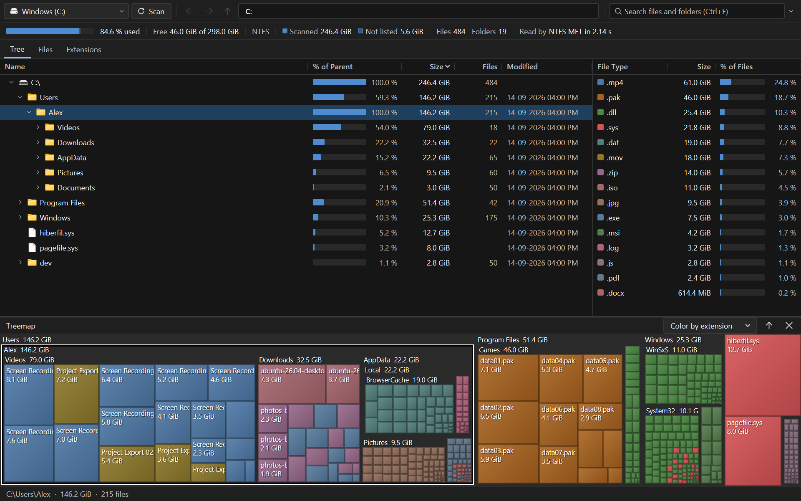
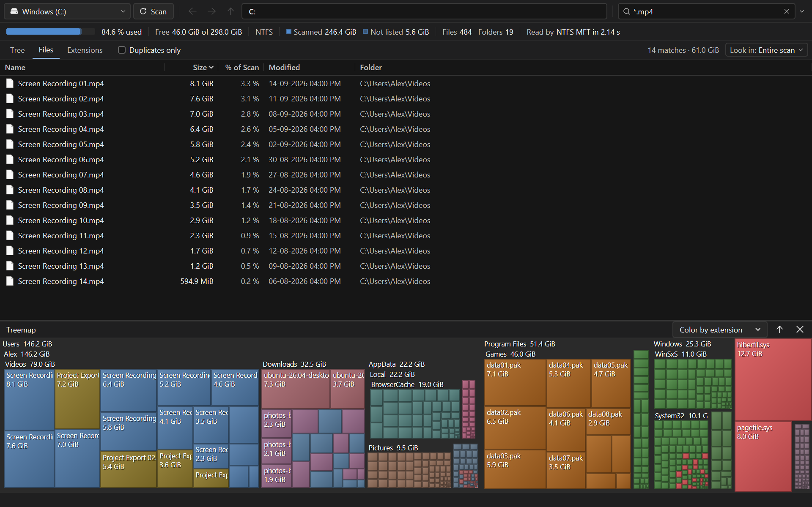

# Quarry 0.2.5

A disk space analyzer for Windows (formerly Stratum), written in Go with the MyGO native UI toolkit (Direct3D, no webview).
Quarry shows where the space went and gets you from a storage problem to the file or folder responsible in a few clicks.

Quarry is an independent project inspired by disk analysis tools such as WizTree.
It is not affiliated with or endorsed by WizTree or Antibody Software.

## License and assets

Quarry's original source and generated artwork are available under the [MIT license](LICENSE).
Dependencies and Fluent icons retain their own licenses; see [third-party notices](resources/licenses/NOTICE.txt)
and [asset provenance](internal/desktop/assets/ASSETS.md). The launcher icon is generated by `scripts/icon.go`.
README screenshots use fictional scan data.

See [publication notes](docs/PUBLISHING.md) for source, history and release checks.



## Layout

From top to bottom: the toolbar (Scan, Rescan, back, forward, up, the location and search), the drive header, the view tabs, the table with the file types panel beside it in Tree View, the treemap and the status bar.

- **Drive header** - the drive, its use as a bar in three parts (the scan, used space the scan does not list or the rest of the drive, free space) with a legend, free space as the large number (in the warning color at 90 % or more), and the scan's file and folder counts and method.
- **Tree** - the folder hierarchy below the current location, sorted by size, with each entry's share of its parent as a bar beside its name. Right/Left expand and collapse (Shift for the whole subtree, bounded at 200,000 rows), Enter or double-click expands folders and opens files, Backspace or Alt+Up goes up.
- **File types panel** - beside the tree: the kinds of files in the scope, largest first, in the treemap's colors, so it is also its legend. Double-click lists a type's files; F8 shows or hides it.
- **Files** - every file in the scope, largest first, or every match of the search. Results are complete (no silent limit) and virtualized.
- **Extensions** - space by file type with Windows' type names. Double-click an extension to list its files.
- **Treemap** - area proportional to size, colored by extension (aggregated blocks take their dominant type), by top-level folder, or monochrome. Click selects the item in Tree View, double-click a folder goes into it, the mouse back button returns.

Selections, the location and the history are shared by the tree and the treemap. Every command lives once in a central registry that drives the menu bar, the context menus and the keyboard shortcuts (Help → Keyboard Shortcuts, F1).

Both themes are held to tested contrast rules: text reaches WCAG 7:1 (secondary text, links and warnings 4.5:1) on every background it is drawn on, and the APCA perceptual measure as well, so grey text stays readable on the dark theme too.

## Working with files

Right-click any entry: Open, Show in Explorer (selects the items), Cut/Copy as real Explorer clipboard items, Copy Full Path (Ctrl+Alt+C), Go Into Folder, Reveal in Tree, Search in This Folder, Scan This Folder, Rename (F2), Delete to the Recycle Bin (Del) and Properties (Alt+Enter). **More** holds Copy Name, Copy Size, Copy Rows as Text (tab-separated), Focus in Treemap, Scan in New Window, Export Selection, Expand/Collapse Subtree and Delete Permanently (Shift+Del, always confirmed). Items can be dragged to Explorer; folders dropped on the window are scanned.

Before any operation Quarry checks that the path still exists and is still the same kind of entry; after it, the index, totals, extensions and treemap update without a rescan. NTFS metadata (`$MFT`, `$BadClus`, `$Extend`…), `pagefile.sys`, `System Volume Information` and similar are never offered for deletion or renaming, and items inside Windows or Program Files get an extra warning.

## Search

Type in the search box (Ctrl+F). Matching is case-insensitive; all terms must match.

```
*.mp4                     wildcards over the whole name (* and ?)
backup  -cache            contains "backup", not "cache"
ext:log size:>500MB       fields can be combined
modified:<2025-01-01      also >, <=, >=, a single day, or a range a..b
path:node_modules         any folder in the path
type:file  type:folder    regex:^IMG_\d+\.jpe?g$
```

Tools → Advanced Search builds such a query from fields. The scope is shown next to the results: the current location by default, following navigation, or the entire scan or a selected folder when chosen. Clearing a search started in Tree View returns to it.



**Show/Hide Filter** (Tools → Show/Hide Filter) hides entries that are already scanned - e.g. show only `ext:log`, hide `node_modules` - and recomputes every total. **Skip During Scan** (Options → Skip During Scan) keeps folders or name patterns out of future scans; a warning beside the view tabs then reports how many entries were skipped.

## Scanning

As administrator, whole NTFS drives are read directly from the master file table (seconds for millions of files). Otherwise - and for folders, FAT/exFAT and network drives - Quarry enumerates directories with `FILE_ID_BOTH_DIR_INFO`. The drive header names the method used (Scanned with) and its tooltip why MFT reading was not possible; Options → Restart as Administrator relaunches through UAC.

Sizes: **Size** is the logical length of files, **Allocated** the disk space they occupy (smaller for compressed or sparse files). View → Size Metric, or a column header's right-click menu, chooses which one percentages, default sorting and the treemap use. Hard links are counted once, junctions and symbolic links are not followed, and unreadable folders are reported (status bar issue count, Tools → Scan Issues). The volume's used space also contains filesystem overhead, so it is shown separately (Tools → Scan Information).

## Saving, exporting, comparing

File → Save Scan As writes a `.quarry` file that opens instantly later (marked as historical data). File → Export writes CSV of the current view, the selection, the entire scan or the extension summary, or JSON. Tools → Compare with Saved Scan shows growth per top-level folder. Tools → Find Duplicates groups same-name/same-size candidates or verifies identical content with SHA-256; it never deletes anything.

## Command line

```
Quarry.exe [folder | drive | file.quarry]
Quarry.exe -scan <folder> [-csv out.csv] [-save out.quarry] [-json] [-exclude pattern]... [-walk] [-quiet]
```

Exit codes: 0 success, 1 failure, 2 invalid arguments, 3 completed with unreadable items. Help → Command Line has the details.

## Settings

Window position, columns (right-click a header to show, hide, fit or reset), sort orders, the active view, treemap visibility and split, the file types panel and its width, units, theme, text size (Ctrl+wheel, Ctrl+=/−/0), recent locations, search history and exclusions are kept in `%APPDATA%\Quarry\settings.json`. Options → Add "Analyze with Quarry" to Explorer registers a per-user context-menu verb on folders and drives; choosing it again removes it.

## Build

```
powershell -File scripts/build.ps1            # tests, vet, MyGO checks, installer in build/windows-amd64
powershell -File scripts/build.ps1 -Portable  # build/portable/Quarry.exe
```

Go 1.27 or later; no cgo. The screenshots are rendered from sample data: `QUARRY_SHOTS=docs/screenshots go test ./internal/desktop -run Showcase`. See [docs/ARCHITECTURE.md](docs/ARCHITECTURE.md) and [CHANGELOG.md](CHANGELOG.md).
