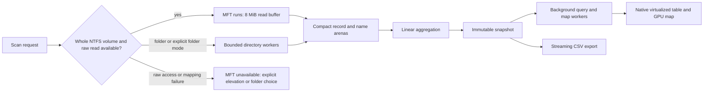

# Research, plan and implementation

## Six-phase October 2026 upgrade

The current implementation and verification record is [UPGRADE.md](UPGRADE.md). The sections below also retain historical baseline decisions.

Desktop composition is split into semantic design tokens, core chrome/summary/dialogs, virtualized exploration, contextual analytics, visualization, interactions/preferences, advanced workflows and exports. The immutable scanner/index contract remains intact.

`Snapshot.Visit` walks a subtree with constant auxiliary memory. Queries honor their root in both file and tree modes. Size/type/date filters and sorting run in cancelable workers. Contextual analytics uses bounded heaps for top 100 files and top 10 immediate directories; frames do not rescan or sort the index. Snapshot and generation identities reject stale analytics, visualization and duplicate results.

Treemap branches and four-level sunburst sectors share metric, scope and deterministic folder colors. Geometry/path caches are invalidated on bounds or input changes. Tiny items remain accounted for in Other aggregates, which lead to the complete indexed file view. Metadata visibility affects only visualization scope. Volume capacity comes independently from Windows; logical and allocated file totals never act as utilization denominators.

Version-1 historical indexes use a gzip stream with a fixed binary header, bounded JSON metadata, explicit little-endian records and the UTF-8 name arena. Reads check limits, gzip integrity, name bounds, root/parent/child relationships and cycles before publishing a snapshot. Writes use a temporary file, flush and rename. Manual retention keeps at most five saves / 256 MiB; each uncompressed index is limited to 128 MiB. Comparisons require matching roots and compute unsigned-safe changes for their immediate children.

Duplicate checking is explicit and independent of ordinary scanning: size candidates, complete SHA-256 hashes, before/after file metadata checks, hard-link identity exclusion and cancellation between read buffers. It reports verified groups and skipped records, with no destructive operations or reclaimable-space claims.

CSV/JSON/report exports stream from a captured immutable snapshot and explicit scope. PNG exports rebuild the bounded treemap at export resolution. UI preferences persist atomically on close or Settings Done; column positions and splitter movements do not trigger per-motion disk writes. MyGO's native window StateKey restores normal/maximized bounds only when they remain on an available monitor.

## 0.0.1 baseline

The Product Design audit and visual QA replace the original dashboard with a compact native utility. See `design-qa.md` for captured evidence and the iteration history. The interface uses Microsoft Fluent System Icons, Segoe UI, neutral surfaces, resizable tables and a nested map; marketing copy and summary cards are removed.

Whole-drive MFT requests now fail explicitly if raw access or mapping validation fails. They never silently switch engines. The user can relaunch via Windows UAC or explicitly select Folders; CLI callers can opt into fallback with `-fallback`. MFT lookups use dense record-index arrays for ordinary tables, preallocated arenas, aligned I/O and direct reads of continuation records already covered by known extents. Hash maps remain only for exceptionally large sparse tables.

File view/search now retains every match and sorts the entire result. The old 10,000-file limit is removed. The map retains up to 4,096 branches, seven nested levels and 96 children per directory, including an aggregate remainder. The historical implementation details below are updated to reflect this behavior.

## Reference findings

WizTree's most consequential performance feature is direct access to NTFS's Master File Table. Its product combines a directory hierarchy, size-ordered file results, a treemap, search, export, and hard-link-aware accounting. Its current official feature list additionally includes duplicate detection, imports, MTP scanning and MFT dumps. Stratum implements the core analysis workflow with its own visual identity; it does not reproduce WizTree branding or proprietary code.

Sources inspected on 16 October 2026:

- [WizTree official overview](https://diskanalyzer.com/)
- [WizTree features](https://diskanalyzer.com/about)
- [MyGO native UI](https://mygo.egoist.dev/docs/ui)
- [MyGO views and goroutine ownership](https://mygo.egoist.dev/docs/ui/views)
- [MyGO virtualized tables](https://mygo.egoist.dev/docs/ui/table)
- [MyGO rendering and drawing](https://mygo.egoist.dev/docs/ui/drawing)
- [MyGO testing](https://mygo.egoist.dev/docs/ui/testing)
- [MyGO distribution](https://mygo.egoist.dev/docs/distribution)
- [MyGO v0.5.5 source](https://github.com/egoist/mygo/tree/v0.5.5)
- [Microsoft NTFS volume metadata specification](https://learn.microsoft.com/en-us/openspecs/windows_protocols/ms-fscc/a5bae3a3-9025-4f07-b70d-e2247b01faa6)
- [Microsoft NTFS record header](https://learn.microsoft.com/en-us/windows/win32/devnotes/file-record-segment-header)
- [Microsoft batched directory metadata example](https://github.com/microsoft/Windows-classic-samples/blob/main/Samples/Win7Samples/winbase/io/extendedfileapis/ExtendedFileAPIs.cpp)

## Stack choice

Pinned MyGO v0.5.5, Go 1.27.1+, and `golang.org/x/sys/windows`. `WindowOptions.Content: ui.View(...)` constructs a native GPU surface. No URL is loaded and no webview is constructed. MyGO itself has optional webview code, but that backend remains uninitialized for these windows. The live process check found no WebView2 child process.

The dependency is young, so the version is pinned. Its native table is virtualized, but its outline currently flattens expanded rows each frame. Stratum instead keeps an immutable flat row list and changes it only after expansion, sorting, searching or navigation. The frame's work depends primarily on visible rows and the bounded treemap, not total disk entries.

## Data flow

The UI owns its state. Scanner and query workers own their transient state and post immutable results through a bounded channel. Generation IDs discard stale search/map results. Closing the window cancels scans and queries. Directory workers are cancelled, their task channel is closed, and their wait group is joined before the scan returns. Query changes are debounced by 180 ms. Scanning requests progress frames at 10 Hz; completed idle views do not continuously request frames. Worker results explicitly invalidate the window.

## Scan correctness

1. Direct mode opens `\\.\C:` for **read only**, obtains NTFS geometry, reads record zero, maps `$MFT` data runs and follows its attribute list when needed. It requires complete contiguous logical run coverage before scanning.
2. Record parsing checks geometry, signatures, update sequence arrays, sector markers, used lengths, attribute offsets, signed run deltas and run coverage. In-use base records are indexed; continuation records contribute stream headers only at starting VCN zero.
3. Logical/allocated data is counted from `$DATA`, with resident values taking no external clusters and sparse/compressed streams using physical allocation. Parent identity includes the sequence number, avoiding incorrect joins to reused records. Parent cycles stop the direct scan; fallback requires explicit opt-in.
4. Directory mode opens only directories for its fast enumeration path. `FILE_ID_BOTH_DIR_INFO` supplies logical length, allocation, attributes and identity. A coordinator deduplicates file IDs within the scanned volume. Reparse directories are retained but not traversed.
5. Inaccessible folders and unknown metadata produce bounded error samples and incomplete flags. Cancellation yields an explicitly partial directory snapshot. An interrupted MFT scan is discarded rather than presented as complete. Unresolved MFT records are visibly grouped at root and their filesystem actions are disabled.

Known differences between engines are intentional and shown in Scan notes. Folder enumeration does not enumerate alternate streams. Direct MFT mode picks one filename per record, so aliases are counted in scan notes rather than reproduced as separate hierarchy entries. Neither path promises Windows-used-space parity or a consistent-time snapshot.

## Memory and time budgets

- `Node`: 56 bytes; integer indices instead of pointers; sizes are 64-bit.
- Names: a single UTF-8 byte arena. Views borrow immutable name slices; paths are reconstructed only for selected rows and export.
- Graph: linked child indices, no slice or full path per record. Aggregation uses a temporary leaf queue and child counters, O(n), without recursive traversal.
- I/O: 64 KiB aligned buffer per directory worker; 8 MiB MFT buffer; batches of 256 entries; two queued batches per worker.
- Identity/reference structures are transient and released after construction. The MFT path uses a dense index for up to 32 million record slots and a hash map above that. A background GC after scan completion releases scratch before steady use.
- Search/file results retain all matching rows, with background O(n log n) sorting and cancellation checks. ASCII matching and name comparisons avoid allocating lowercase filename copies.
- Directory rows are rebuilt in the background. Expanded depth is capped at 256 to avoid pathological UI trees. Sorting is on demand.
- The nested map retains at most 4,096 branches, with a per-directory aggregate remainder and seven levels. Geometry is cached until items, metric or bounds change. Its drawing uses one native surface instead of a widget per file.
- Disk capacities come from Windows; displayed analyzed sizes come from actual scan records. The empty state contains no fabricated scan results.

## Delivery phases

| Phase | Status | Evidence |
| --- | --- | --- |
| Research and stack pinning | Complete | Official references and checked v0.5.5 source |
| Compact scan index and folder engine | Complete | Hard-link, sparse, junction and cancellation tests; real C: scan |
| Direct NTFS engine | Implemented, physical-volume validation pending | Parser tests, synthetic volume integration, fuzzing; raw access denied in this session |
| Native exploration UI | Complete for preview | Headless navigation/search/resize tests and actual Windows render inspection |
| Build and installer | Complete | MyGO Windows executable and NSIS installer |
| Production release validation | Pending | Elevated real-volume matrix, more hardware, signing and accessibility review |

## Before a production release

Test direct scans on elevated physical NTFS volumes, including large fragmented `$MFT` attribute lists, 4Kn drives, named streams, compressed/sparse files, multiple hard-link names and live churn. Compare controlled fixtures with Windows metadata and a same-machine WizTree scan. Exercise FAT/exFAT, ReFS and SMB providers, disconnects, long paths, restricted ACLs and very large directories. Measure peak RSS, retained heap, cancellation latency, I/O throughput and frame costs over multiple runs. Verify keyboard-only navigation, screen readers, DPI scaling, Windows contrast themes, and the unsigned-to-signed packaging path.

Do not market the direct reader as proven to match WizTree performance until that matrix is complete. MyGO's native mode is GPU-drawn native desktop UI; it does not use Win32 common controls for every widget. That distinction is compatible with the requested native MyGO stack.
